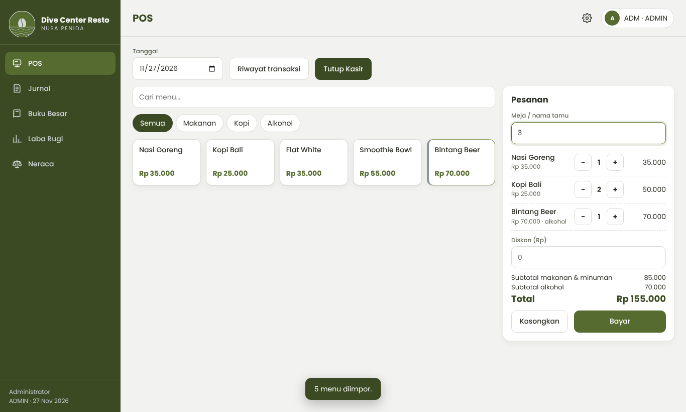
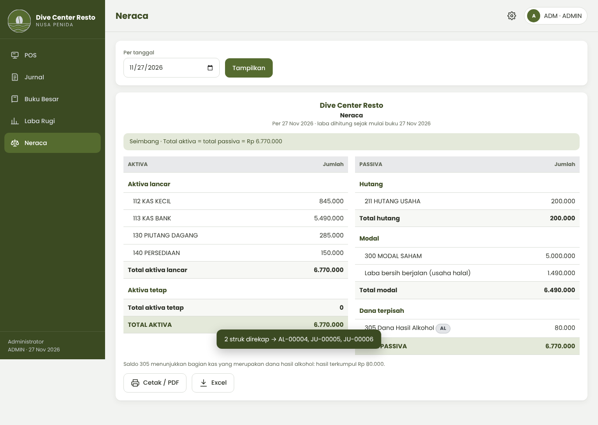
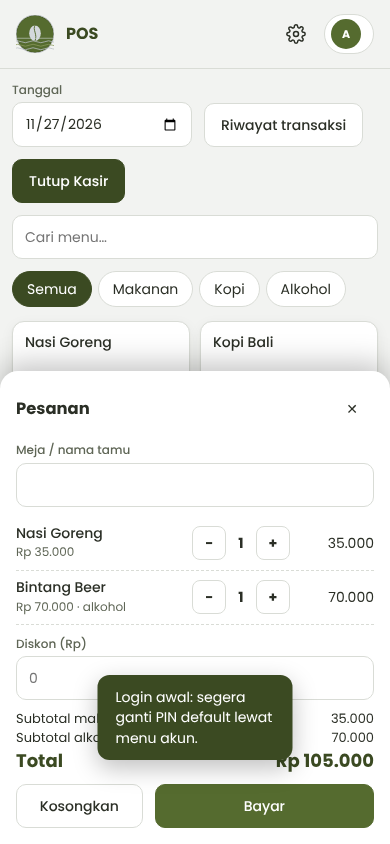
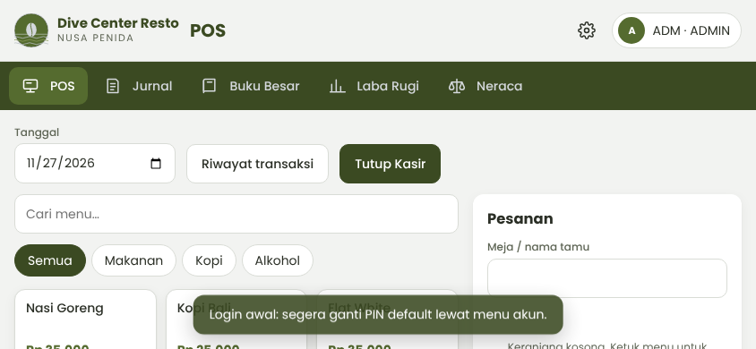

# Dive Center Resto — Aplikasi Akuntansi

Aplikasi pencatatan akuntansi untuk **Dive Center Resto, Nusa Penida**.
Dibangun dengan **Google Apps Script** dan **Google Sheet** sebagai database.
Bisa dibuka di HP (portrait & landscape) dan laptop.

**Buka aplikasi:** [https://agungswn.github.io/dc-resto/](https://agungswn.github.io/dc-resto/)  
Alamat langsung (Apps Script): [script.google.com/…/exec](https://script.google.com/macros/s/AKfycbxLvv4j-rXGofcjWnm8OhlTLZMAra1ghMC1Wx4FDNiriUm01LyTqynmkm0cYIOjuLtB/exec)

Di HP, buka alamat GitHub di atas lalu pilih **Tambahkan ke layar utama**: aplikasi muncul dengan ikon logo resto.



## Fitur

| Tab | Isi |
|---|---|
| **POS** | Grid menu, keranjang, diskon, bayar Tunai/EDC/QRIS/Transfer/Bon, struk (thermal 58 mm, WhatsApp, PDF), void, Tutup Kasir harian. Aktif setelah daftar menu diisi. |
| **Jurnal Umum** | Daftar jurnal, Penjualan Harian (sementara sebelum POS aktif), jurnal manual, Pembelian Alkohol, Stok Opname. |
| **Buku Besar** | Mutasi per akun dengan saldo berjalan, plus **Buku Pembantu**: piutang pelanggan, piutang karyawan, hutang supplier, saham per pemegang saham. |
| **Laba Rugi** | Bagian 1 usaha halal (Pendapatan, HPP dari stok opname, Beban, Zakat Mal, Laba Bersih). Bagian 2 Perhitungan Hasil Alkohol, terpisah. |
| **Neraca** | Aktiva vs passiva dengan penanda seimbang; Dana Hasil Alkohol (305) ditampilkan terpisah. |
| **Pengaturan** | Profil resto, bagan akun, menu (impor dari Excel), kontak, saldo awal, pengguna & PIN, log aktivitas. |

### Aturan penting

- **Penjualan otomatis masuk Jurnal Umum**: rekap harian saat Tutup Kasir (atau otomatis tengah malam), dipisah tunai (112) / non-tunai (113) / bon (130).
- **Alkohol dipisah** (pertimbangan halal–haram): jurnal halal `JU-xxxxx`, jurnal alkohol `AL-xxxxx`; akun alkohol tidak bisa dipakai di jurnal halal. Hasil alkohol terkumpul di akun **305 Dana Hasil Alkohol**, tidak masuk Laba Bersih maupun dasar zakat. Kas tetap satu, tiap mutasi bertanda kelompok.
- **5 peran**: Kasir, Operator, Spv, Admin, Pemilik. Login dengan PIN; hak akses dicek di server.
- **Pajak PB1 & service** sudah disiapkan (akun 220, 221), tarif awal 0%.
- Bagan akun awal: 53 akun dari Excel `DC_RESTO_AGU_2026` + 152 Persediaan Alkohol, 220, 221, 305.
- Tampilan: hijau lumut & silver, font Poppins, logo Emblem Pantai.

## Struktur repositori

```
src/            kode Apps Script (yang dipasang ke Google)
  Code.gs         server: setup, login, jurnal, POS, laporan
  Index.html      kerangka halaman
  Css.html        tampilan (responsif 3 ukuran layar)
  Js.html         logika tampilan
  appsscript.json manifest (zona waktu WITA, aplikasi web)
test/           pengujian
  test.js         uji logika akuntansi (neraca seimbang, HPP, pemisahan alkohol, rekap POS)
  gasmock.js      simulasi lingkungan Google Apps Script
  e2e.js          uji ujung-ke-ujung di browser (Playwright)
docs/           panduan pasang dan cuplikan layar
index.html      pembungkus GitHub Pages (memuat aplikasi Apps Script layar penuh)
manifest.webmanifest, icon*  ikon & data untuk "Tambahkan ke layar utama"
```

## Pasang

### Cara A — salin-tempel (tanpa alat tambahan)

Ikuti [docs/PANDUAN_PASANG.md](docs/PANDUAN_PASANG.md). Ringkasnya:

1. Buat Google Sheet baru → **Ekstensi → Apps Script**.
2. Tempel `src/Code.gs`, lalu buat file HTML `Index`, `Css`, `Js` dari folder `src/`.
3. Jalankan fungsi `setup` sekali, lalu `pasangTriggerTutupKasir`.
4. **Terapkan → Deployment baru → Aplikasi web** (Jalankan sebagai: Saya, Akses: Siapa saja).
5. Saat ini aplikasi dalam **mode pengembangan**: langsung terbuka tanpa login sebagai Admin (peran bisa diganti dari menu akun). Untuk mengaktifkan login, ubah `TANPA_LOGIN = false` di `src/Code.gs`, terbitkan ulang, lalu masuk dengan kode **ADM**, PIN **123456**.

### Cara B — dengan clasp (langsung dari repositori)

```bash
npm install
npx clasp login
# buat Google Sheet, buka Ekstensi → Apps Script, salin Script ID dari Setelan Proyek
cp .clasp.json.example .clasp.json   # isi scriptId
npx clasp push
```

Lalu jalankan `setup` dan `pasangTriggerTutupKasir` dari editor Apps Script, dan buat deployment aplikasi web.
Untuk pembaruan berikutnya: `npm run push`, lalu **Kelola deployment → Versi baru**.

## Pengujian

```bash
npm test            # uji logika akuntansi (tanpa Google)
npx playwright install chromium
npm run test:e2e    # uji tampilan + server tersimulasi di laptop, HP portrait, HP landscape, tablet
```

## Cuplikan

| Neraca | HP portrait | HP landscape |
|---|---|---|
|  |  |  |
